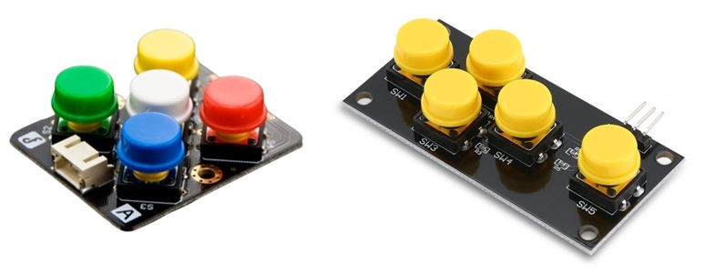
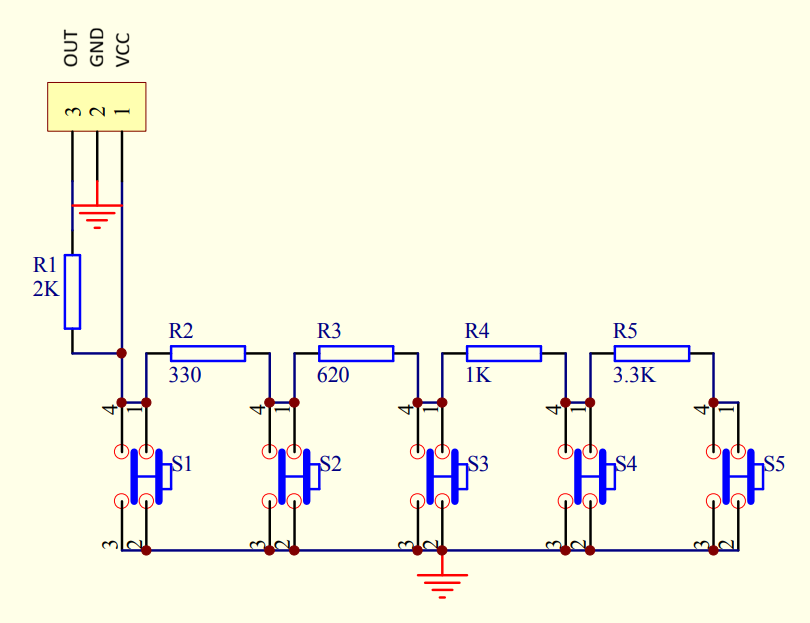

# Arduino Library for 5-Key Analog Keypad

If you need a very cheap keypad for a simple user interface or menu control with Up, Down, Left, Right and Next keys, then an analog keypad will do the job. These are very cheap and are available everywhere.



The keypad output is connected to a single analog input. Each key forms part of a resistor voltage divider network. Pressing a key changes the output voltage according to the key.


## Advantages of this library

This library has some advantages over other libraries:

* Ignores multiple keys pressed at the same time, only one key can be active at a time
* Configurable repeating keys: hold the key down for a short time then the key repeats at a configurable rate, the default is no keys repeat
* Easily adapted for different keypad circuits, key voltages, MCU voltages and ADC resolutions

You can also adapt it for keypads with any number of keys.


# Typical Circuit

The keypad I used (from AliExpress) happens to have exactly the same circuit as the 'DFRobot Gravity: Analog ADKeyboard Module (SKU: DFR0075)' board, although the boards look completely different. 

In the pictures above, the DFRobot board is on the left, my board is on the right. I prefer the key layout on my (much cheaper) board. 




## Adapting the code for different key voltages, ADC reference voltages and ADC resolutions

There are many different keypad circuits, each using different resistor values to produce different output voltages for each key. This means you must measure the output voltage for each key and modify the software according to your board. The software is also dependent on the analog input reference voltage (3.3V or 5V), and the resolution of the analog-to-digital converter (ADC) which is usually 10 or 12 bits.

The voltage output for each key must be measured, and the code adapted to match the measurements.

Connect GND and connect VCC to 3.3V or 5V, depending on your MCU's VCC. Connect OUT to the A0 analog input, and enable this test code in the example sketch. You may need to modify it for your VCC (3300 or 5000mv) and ADC resolution (10-bit = 1023 or 12-bit = 4095).

```cpp
// enable this to measure the key voltages in millivolts
#if 1
while (1) {
    // calculate millivolts
    // this depends on your VCC and the ADC resolution
    // 3300 = analog reference voltage, use 5000 for 5V
    // 1023 = max ADC count at reference voltage, 1023=10 bit, 4095=12 bit
    int mv = (analogRead(A0) * 3300) / 1023;
    Serial.println(mv);
    Serial.flush();
    delay(1000);
}
#endif
```

As each key is pressed, write down the voltage it produces in millivolts. See the values in the Millivolts column of the table below.

Now calculate the millivolt reading that is half way between each key. See the values in the Midpoint column. These are the values you will use in the software. 

It is better to use millivolts because it is easy to adapt millivolts for different microcontrollers (3.3V or 5V) and analog-to-digital converters (ADCs) with different resolutions (10-bit 0..1023, 12-bit 0..4095, etc).

These are the results I got for my keypad,

| Key     | Millivolts  | Midpoint   | Key Name    |
|:------- |:---------   | ---------: | :---------- |
| SW1     | 0           |            | Left        |
| SW2     | 464         | 232        | Up          |
| SW3     | 1058        | 760        | Down        |
| SW4     | 1625        | 1340       | Right       |
| SW5     | 2390        | 2008       | Next        |
| none    | 3300        | 2845       |no key pressed |


Now modify the library code in `readKey()` to use your own half-way values, starting with the 'no key pressed' value (the most common state). 

For some keypads you may have to use `<` instead of `>`, and go from low to high instead of high to low.

```cpp
// Get the key code according to the analog input voltage
// modify this according to your boards
// or it can be overridden in a derived class
AnalogKeypad5::Key AnalogKeypad5::readKey()
{
    // calculate millivolts
    // this depends on your VCC and the ADC resolution
    int mv = (analogRead(pin) * 3300) / 1023;

    if (mv > 2845)
        return Key::None;
    if (mv > 2008)
        return Key::Next;
    if (mv > 1340)
        return Key::Right;
    if (mv > 760)
        return Key::Down;
    if (mv > 232)
        return Key::Up;
    return Key::Left;
}
```

Instead of modifying the library code (which is naughty), you can create a derived class and override `readKey()`, as shown in the example sketch.

```cpp
#include "AnalogKeypad5.h"

// Derived class to adapt it for your MCU and keypad
class MyAnalogKeypad5 : public AnalogKeypad5
{
protected:
    MyAnalogKeypad5::Key readKey();
};

// Get the key code according to the analog input voltage
// modify this according to your boards
// or it can be overridden in a derived class
MyAnalogKeypad5::Key MyAnalogKeypad5::readKey()
{
    // calculate millivolts
    // this depends on your VCC and the ADC resolution
    int mv = (analogRead(pin) * 3300) / 1023;

    if (mv > 2845)
        return Key::None;
    if (mv > 2008)
        return Key::Next;
    if (mv > 1340)
        return Key::Right;
    if (mv > 760)
        return Key::Down;
    if (mv > 232)
        return Key::Up;
    return Key::Left;
}

MyAnalogKeypad5 keypad;
```


## Class Reference

For more details, see the comments for each method in the [source code](src/AnalogKeypad5.h).


```cpp
class AnalogKeypad5
{
public:
    // repeat key timing in milliseconds
    uint repeatKeyDelayMs = 500;    // > repeatKeyRateMs
    uint repeatKeyRateMs = 100;        // >= pollRateMs

    // Bit flags are used, for repeat key handling
    typedef enum : uint
    {
        None = 0x00,
        Up = 0x01,
        Down = 0x02,
        Left = 0x04,
        Right = 0x08,
        Next = 0x10        // sometimes called Enter, Back, Select, etc.

    } Key;

    bool begin(uint kbPin, uint pollRateMs = 100);
    Key pollKey();
    void enableRepeatKey(Key key);
    void disableRepeatKey(Key key);
    bool isRepeatKey(Key key);

protected:
    // this can be overridden in a derived class,
    // for different boards, VCC voltages and ADC resolutions
    virtual Key readKey();
};
```


## Example Sketch

See [AnalogKeypad5.ino](examples/AnalogKeypad5/AnalogKeypad5.ino).

The example sketch shows how to create a derived class and override `readKey()` to configure it for your own MCU and keyboard. 

It also enables the Up and Down keys to repeat, with a slightly longer repeat key delay (750mS instead of 500).


## Revision History

| Date       | Version  | Details |
|:---------- |:---------|:----------- |
| 2026.10.28 | 1.0.0    | First release |

<br/>


## Joke of the Week

To err is human. To _really screw things up_ requires a computer.


